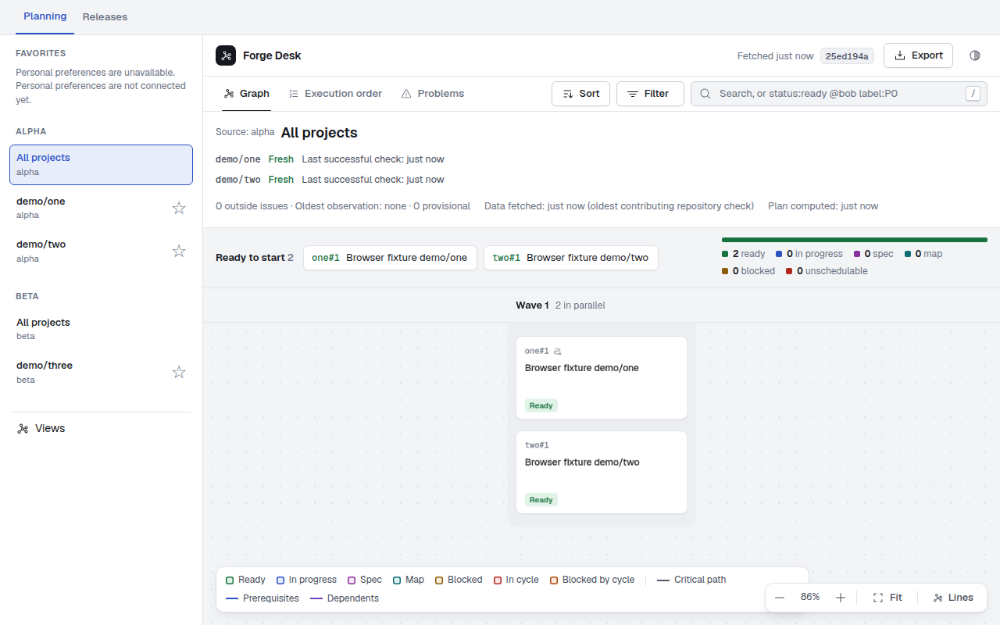
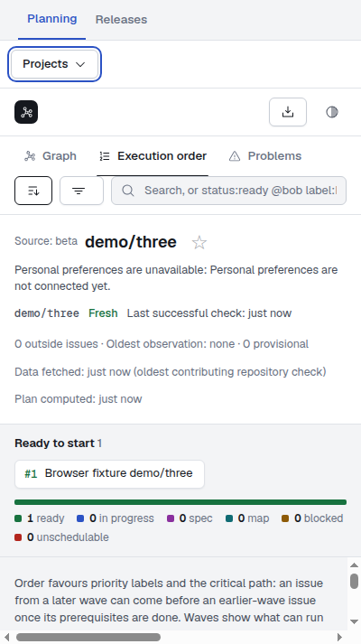
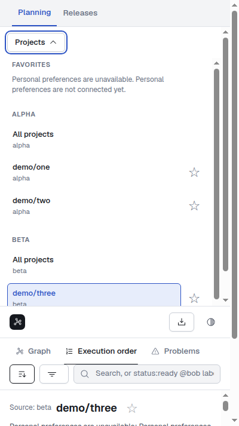

# Web navigation browser evidence

- Issue: [#192](https://github.com/brunoorsolon/forge-desk/issues/192)
- Application and test candidate: `7e61635aaa47c5a8de385668ba270f25516b0437`.
- [Successful CI run](https://github.com/brunoorsolon/forge-desk/actions/runs/42418836383),
  including the complete suite, Docker smoke and all three forge integrations.
- [Full browser artifact: nine PNGs and JSON](https://github.com/brunoorsolon/forge-desk/actions/runs/42418836383/artifacts/13592422281).
- Environment: Ubuntu GitHub runner, Node 22, real headless Chromium, production-built web app
  and actual HTTP scope runtime with two controlled fixture sources. No live forge access.
- Command: `node scripts/check-navigation-browser.mjs` after `npm run build`.
- Result: 27 browser checks passed in approximately 16 seconds; complete CI approximately 98 seconds.

The attached screenshots show the integrated desktop source view (1280×800), narrow project
view and keyboard-opened sidebar (400×713). The fixture recorded source fallback, direct scope
navigation, exact current selection, filter/detail clearing with tab/sort retained, keyboard
selection/disclosure/Escape/focus, Back/Forward, scope exports, named-view and Releases
compatibility, all relevant freshness/error states, 2-second active-job follow-up, real-tab
hidden pause/return and zero/nonzero periodic checks. The one-minute periodic checks use
Chromium's virtual clock; application timers and visibility are not mocked.

These are browser qualification artifacts, not an independent review. Preference persistence
and refresh mutations remain in their separate wiring tickets. The screenshots are committed
without changing the application or browser script tested above; CI reruns against the final
PR head containing this evidence.

## Desktop

## Narrow project

## Narrow sidebar opened using the keyboard

