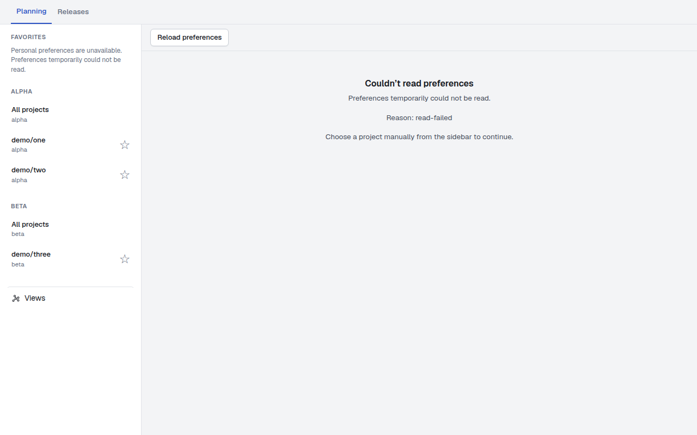
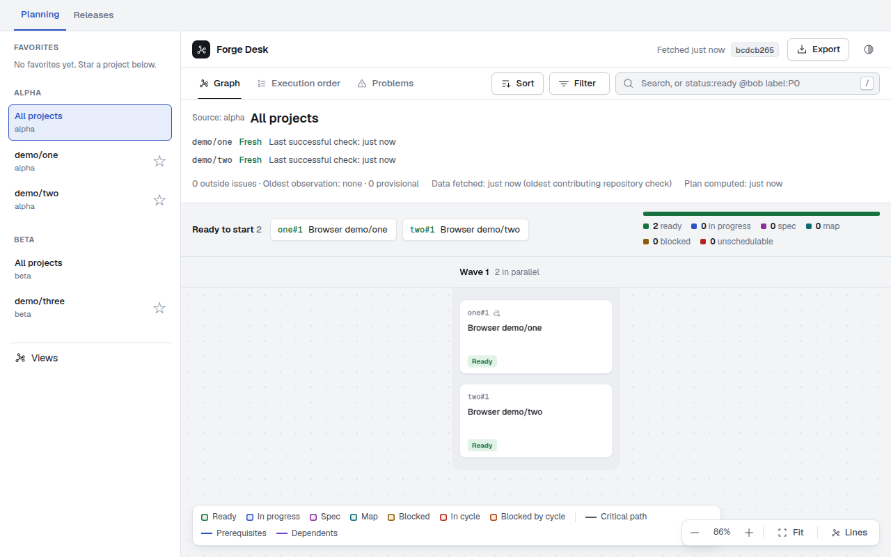
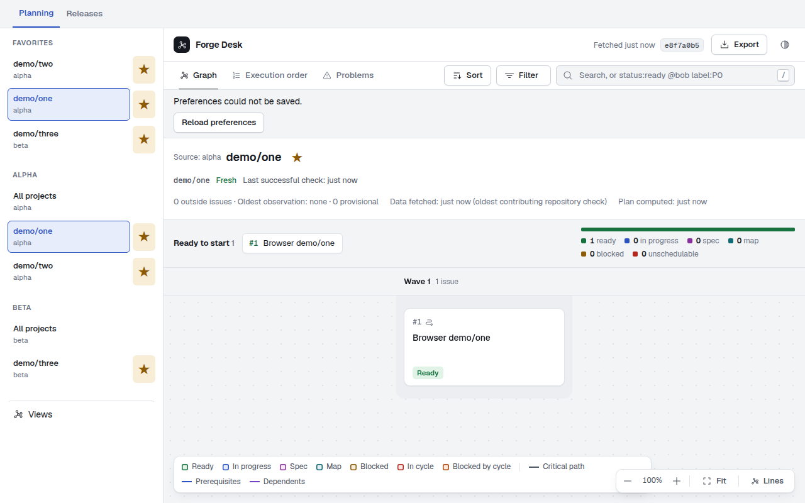
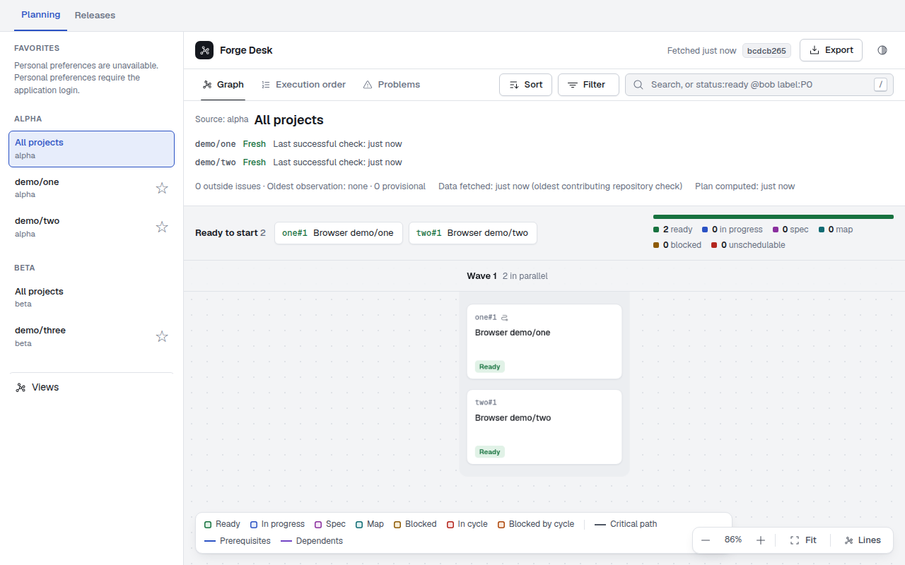
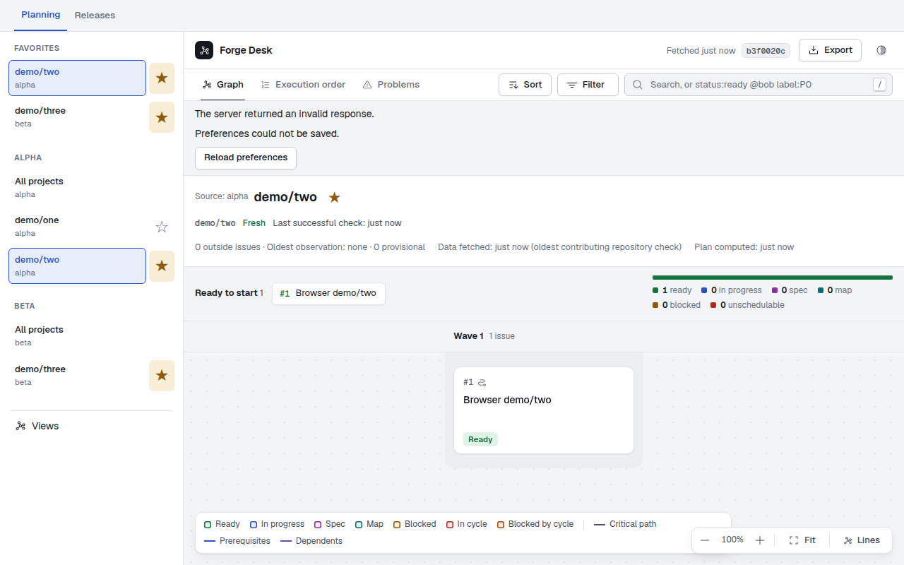
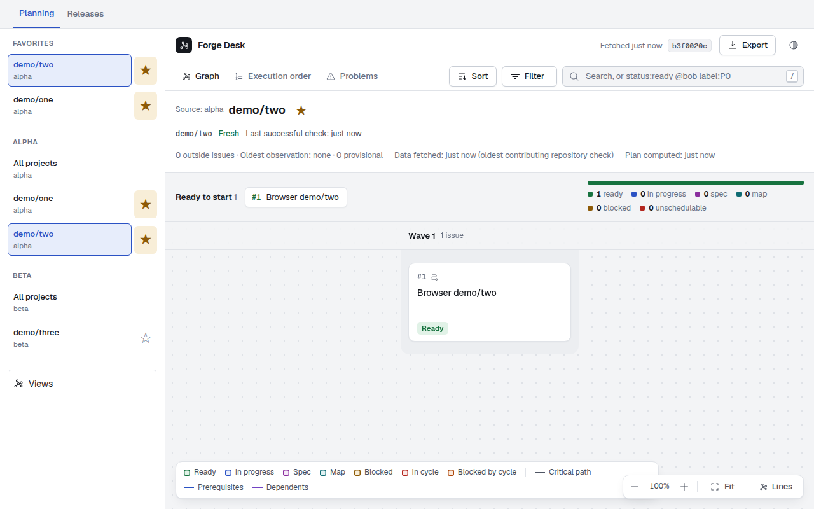
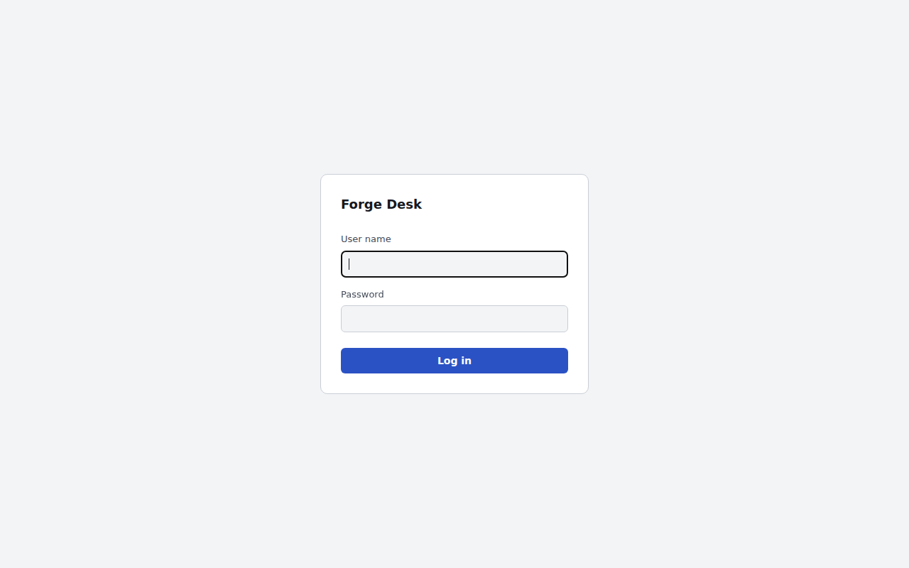
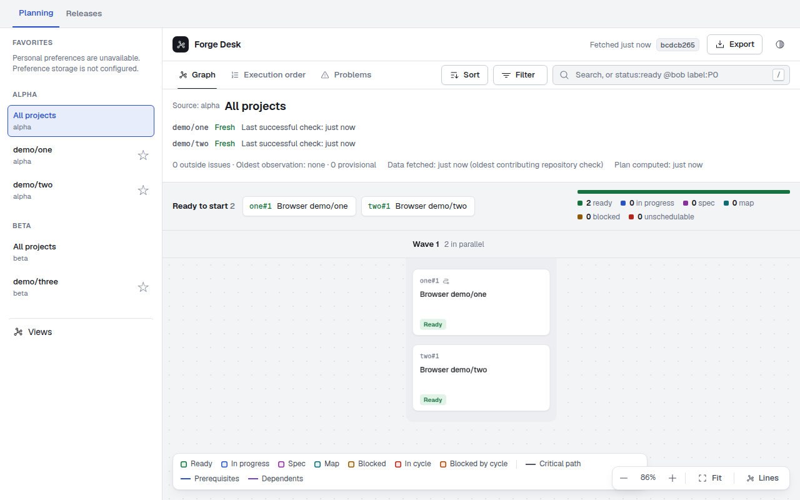
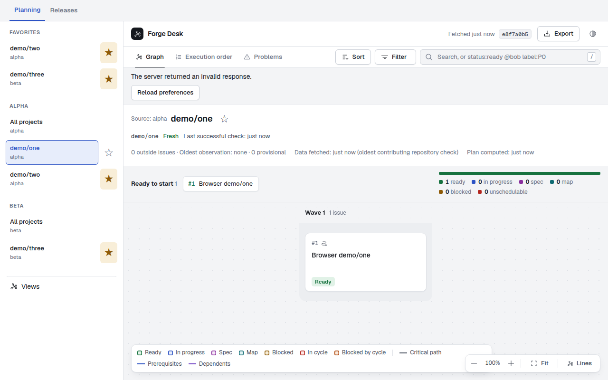
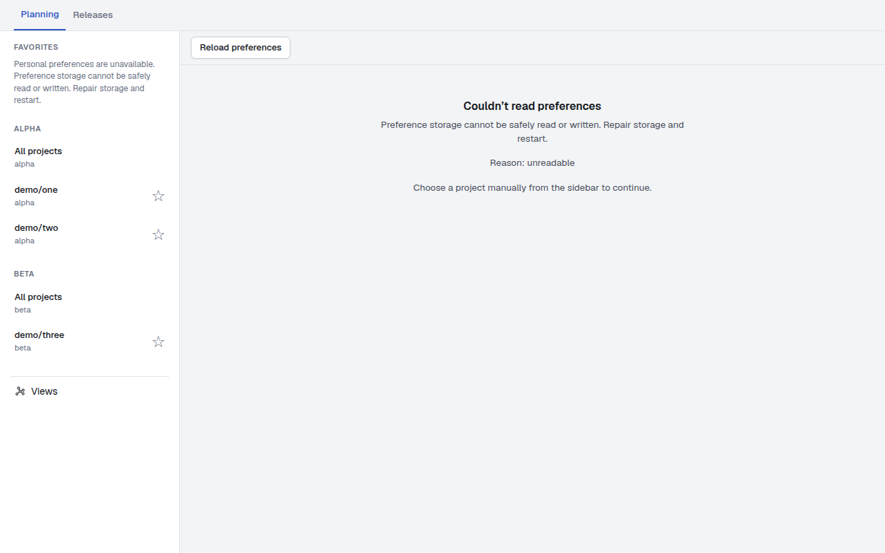

# Web preference wiring browser evidence

Captured from application/test candidate `6e94227cf238dba689f12f438062470b28751027` on 2026-11-07.

[Successful CI run](https://github.com/brunoorsolon/forge-desk/actions/runs/42425376662) ·
[Original browser artifact](https://github.com/brunoorsolon/forge-desk/actions/runs/42425376662/artifacts/13594389034).

The production-built app passed 23 checks in 3.623 seconds in real headless Chromium.
Two isolated browser contexts have separate sessions/cookies and share one real HTTP
server and file-backed preference runtime. Real sibling tabs trigger visibility changes;
application state, fetch and document visibility are not mocked.

Fixtures replace upstream issue data, deliberately reject one save, truncate the
successful JSON payload after a durable commit, and fail one preference read.
The unreadable scenario uses the real unavailable API response for configured storage
without a running store. It tests the UI error state, not filesystem repair.
Chromium can transparently retry an idempotent DELETE whose connection closes before
headers, so payload truncation ensures the app actually receives an ambiguous response
and must reconcile it with a GET. Controller tests separately cover rejected network IO.

All five CI jobs passed, including typecheck, the full test suite, formatting, build,
18 heading layout cases, 27 existing navigation checks, Docker smoke and three forge
integrations. Local Chromium cannot start under executor socket restrictions and Docker
is absent; browser and container results are from CI, not local execution.

The final integration commit incorporates main `0403d61b55dbcd063a65e91d4d30822ca061c9f2`
and these evidence files. Web application bytes are unchanged from the captured candidate.
The browser harness subsequently gained a polling guard for expected document replacement
during login/logout; assertions and mutation actions are unchanged. Local merged validation passed 2,636 tests (73 files),
typecheck, format and build. The PR links the final-head CI and its fresh browser artifact.

## Recorded checks

- Add/remove/re-add persists insertion order through real session and CSRF HTTP mutations
- Second isolated profile starts at first favorite
- Tab return synchronizes ordered favorites across isolated profiles
- A remote remembered-project change never moves an already open page
- Bare startup resumes the remembered project across profiles
- Source/view navigation, tab/query changes and passive reads do not remember
- An explicit project deep link is remembered
- Failed favorite save restores confirmed order and shows an error
- Truncated save-response error is visible after reconciliation
- Truncated save response reconciles the committed disk state by a fresh GET
- Failed remember keeps navigation usable without changing the stored selection
- Session expiry clears personal favorites on the first unauthorized read
- Retry after session expiry requires login and does not replay preference mutations
- Logout clears personal UI synchronously before the HTTP response
- Explicit logout leaves no personal favorites visible
- Failed bare preference read does not silently choose a destination
- Bare preference-error retry rereads and resolves startup after recovery
- login-disabled keeps personal controls unavailable
- login-disabled permits source fallback
- storage-not-configured keeps personal controls unavailable
- storage-not-configured permits source fallback
- unreadable keeps personal controls unavailable
- Configured unreadable storage blocks silent bare fallback

## Screenshots

### Bare read failure

### Bare read recovered

### Favorite save failure

### Login disabled

### Remember failure

### Second profile favorite fallback

### Session expired

### Storage not configured

### Truncated response recovered

### Unreadable

